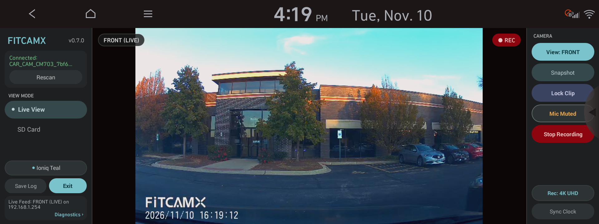
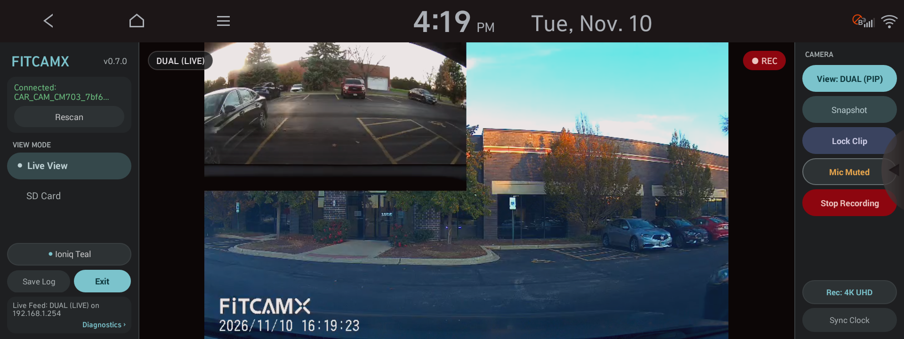
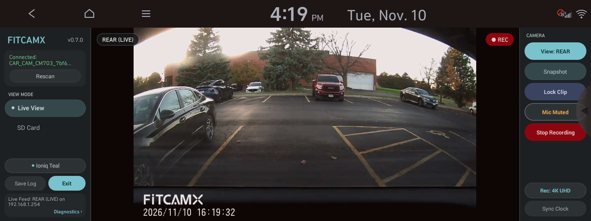
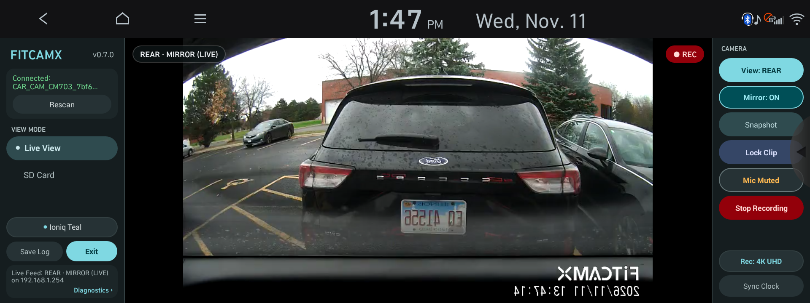
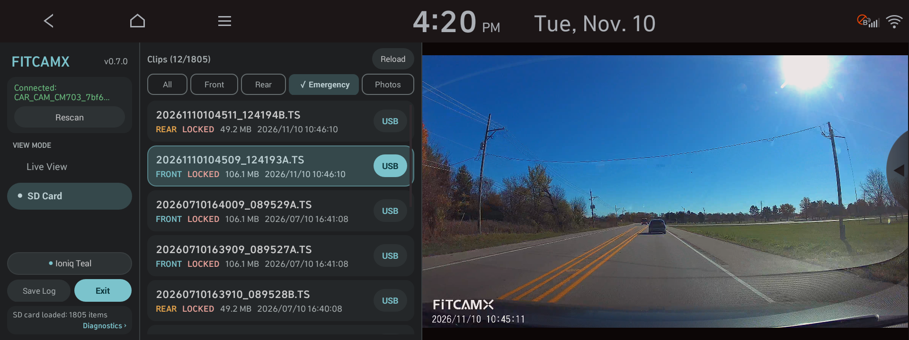
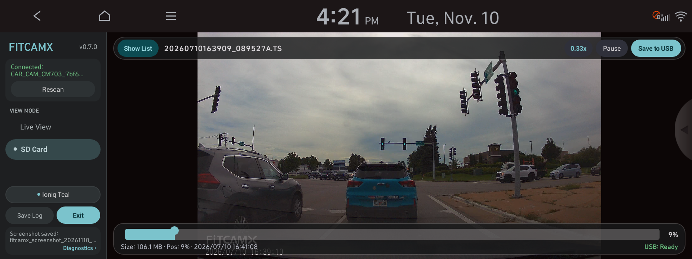

# FITCAMX for Gen5W (Hyundai / Kia / Genesis)

-blue.svg)


[](LICENSE)
[](https://github.com/lemoyneiv/fitcamx-gen5w/releases)

A native, high-performance dashcam viewer and controller application specifically engineered for Hyundai, Kia, and Genesis **Gen5W** navigation head units (10.25" and 12.3" widescreen displays running Android 4.4.2 KitKat API 19).

Designed specifically for **FITCAMX** integrated dashcams (Novatek NT96670 / NT96672 / NT96675 series chipsets).

---

## Screenshots

The application is specifically engineered for Gen5W 24:9 ultra-widescreen infotainment displays (1920×720 and 2560×720), featuring a themable **Material Design 3** interface (shown below in **Ioniq Teal**), ergonomic driver-side stadium pill controls, full-height centered 16:9 video surfaces, and auto-hiding smoked-glass overlays.

### Live View (Front, Dual PiP, Rear & Rear Mirror Streams)
*RTSP live monitoring with non-disruptive channel switching, per-view horizontal mirroring (`Mirror: ON`), real-time status badges, instant snapshot, emergency clip lock, and camera settings.*



*Dual-camera Picture-in-Picture (PiP) live stream*



*Rear camera 1080p live stream*



*Rear camera with rearview-mirror horizontal flip (`Mirror: ON`)*



### SD Card Footage & Still Photo Gallery
*Indexed SD card media browser with `All`, `Front`, `Rear`, `Emergency`, and `Photos` filter chips, compact M3 clip cards, 4K HEVC playback, and direct USB export.*



*File picker hidden for full-height 1120×630 playback with auto-hiding smoked-glass toolbar & scrub bar overlays*



---

## Installation

### Prerequisites
- Head unit jailbroken/rooted with **[HMG-API](https://github.com/VysseCodes/HMG-API)** (v1.0.0+) or **NEMESIS Manager**.

### Method 1: HMG-API USB Installation (Recommended)
1. Download the latest release package: [**`fitcamx-gen5w-v0.7.0-hmgapi-usb.zip`**](https://github.com/lemoyneiv/fitcamx-gen5w/releases/download/v0.7.0/fitcamx-gen5w-v0.7.0-hmgapi-usb.zip) (also available in [`dist/`](dist/fitcamx-gen5w-v0.7.0-hmgapi-usb.zip) or on the [GitHub Releases page](https://github.com/lemoyneiv/fitcamx-gen5w/releases/tag/v0.7.0)).
2. Extract the archive onto the root of a FAT32-formatted USB flash drive.
   - The flash drive will contain `HMGAPI/updates/fitcamx-gen5w-v0.7.0.zip`.
3. Insert the flash drive into the vehicle's multimedia USB port.
4. Open the **HMG-API** app on the infotainment screen.
5. Go to **Updates**, select **FITCAMX Dashcam**, tap **Install**, then tap **Apply changes**.
6. Tap **Restart unit** (or reboot). The FITCAMX icon will appear in your application launcher.

### Method 2: NEMESIS Package Store
1. Download [**`fitcamx-gen5w-v0.7.0-nemesis-usb.zip`**](https://github.com/lemoyneiv/fitcamx-gen5w/releases/download/v0.7.0/fitcamx-gen5w-v0.7.0-nemesis-usb.zip) (or package [`dist/fitcamx-gen5w-v0.7.0-nemesis-package.zip`](dist/fitcamx-gen5w-v0.7.0-nemesis-package.zip)) and copy to your USB drive.
2. Launch NEMESIS Manager on the head unit and install the package.

---

## Highlights & Features

- **Embedded LibVLC 3.3.4 Media Engine:**
  - Self-contained software & hardware decoding pipeline (`libvlc.so`, `libvlcjni.so`, `libc++_shared.so`).
  - **Zero external codec dependencies** — operates standalone without requiring codec packs or system modifications.
  - Smooth RTSP streaming with sub-second latency for Front, Rear, and Dual camera feeds (`rtsp://192.168.1.254/xxx.mov`), kept continuously active via Novatek `cmd=3016` heartbeats, `1.2s` RTP/frame stall detection (`IMedia.Stats`), and silent zero-CGI self-healing RTSP reconnects (`~160 ms`).
  - Uninterrupted recording: Live stream monitoring does not pause or interrupt ongoing dashcam recording.

- **Dual-Profile SD Card Playback Engine:**
  - **Front 4K / 1440p HEVC Clips:** Because the vehicle's Telechips TCC803x processor lacks hardware HEVC decoding silicon, Front clips are played via a specialized keyframe review engine. The player decodes full-resolution intra/keyframes in high quality while dilating presentation timing (`0.33x` slideshow pacing) and decoupling stream clocks (`:no-ts-trust-pcr`). This allows crystal-clear incident review without overloading the 1.0 GHz Cortex-A7 CPU cores or dropping frames.
  - **Rear 1080p H.264 Clips:** Plays at full 30 fps 1.0x speed with complete hardware/SIMD acceleration.
  - Audio is automatically muted during gallery playback to prevent interfering with vehicle radio/audio focus.

- **Material Design 3 (`m3.material.io`) Themable Interface:**
  - Includes **6 curated automotive color themes** tailored for Gen5W cabins: **Ocean Blue** (default), **Ioniq Teal**, **M3 Violet**, **Kia Crimson**, **Genesis Copper**, and **Daylight (Light)**.
  - Built natively for Android 4.4.2 KitKat (API 19) with zero external UI library overhead: tonal surface hierarchy, stadium pill controls, `8dp` filter chips, `12dp` clip cards, state-layer press feedback, and verified WCAG AA (`>= 4.5:1`) contrast across every role.
  - **Live Hot-Swapping:** Tap the sidebar theme pill to pick a palette, or long-press to cycle themes immediately without restarting the app or interrupting active video playback.

- **Optimized 24:9 / 8:3 Widescreen Interface & Full-Height Playback:**
  - Ergonomic vertical navigation rail along the left display edge for direct driver reach.
  - **100% Full-Height Video Viewports:** Both Live View and SD Card Footage span the full `630px` vertical app window (`1026×578` with the clip list open; **`1120×630`** when **Hide List** is tapped), using auto-hiding smoked-glass floating toolbars and scrub bars that never compress or reflow the video surface.
  - Automatic aspect ratio protection (`android.max_aspect="4.0"`) and dynamic surface layout scaling ensure video feeds are always centered with true 16:9 geometry and zero letterbox distortion.

- **Complete Dashcam Remote Control:**
  - **Camera Switching:** Instantly switch between Front, Rear, and Dual live feeds.
  - **Per-View Live Mirroring:** Toggle horizontal live mirroring (`Mirror: ON / OFF`) independently for Front, Rear, and Dual views — ideal for rearview-mirror orientation on the Rear camera while keeping recorded SD card files unflipped so license plates and timestamps remain readable.
  - **Resolution Setting:** Toggle between 4K UHD (`par=0`) and 2K QHD (`par=1`) recording modes with active badge confirmation.
  - **Microphone Control:** Toggle in-cabin audio recording with real-time status query verification (`cmd=2007`).
  - **Instant Snapshot:** Capture still photos while video recording is active (`cmd=2017` / `cmd=1001`).
  - **Emergency Lock:** Write-protect current video segments (`cmd=2001&par=2` / `cmd=2011&par=3`).
  - **Automatic Clock Sync:** Synchronizes dashcam internal RTC date and time with the car's system clock (`cmd=3005` + `cmd=3006`) upon connection.

- **SD Card Footage & Still Photo Review + Direct USB Export:**
  - Fast directory indexing with session caching: loads and filters clips and snapshots from `CARDV/Movie`, `CARDV/EMR`, and `CARDV/PHOTO`.
  - Filter by `All`, `Front`, `Rear`, `Emergency` (locked clips), and `Photos` (still snapshots) with in-app still photo previewing.
  - Direct SD-to-USB transfer: export selected video clips and still photos directly from the camera to an attached car USB drive (`/storage/usb0/DashcamFootage/`) with live progress, write speed indicators, and transfer cancellation.

- **Tap-to-Screenshot to USB:**
  - Tap the top-left **FITCAMX** logo at any time to save a full PNG screenshot strictly to the attached USB flash drive (`DashcamFootage/fitcamx_screenshot_YYYYMMDD_HHMMSS.png`) with zero internal `/data` flash writes.

- **Intelligent Wi-Fi Handover & Clean State Restoration:**
  - Automatically transitions between the head unit's SoftAP and client (STA) mode to connect to the dashcam's Wi-Fi network.
  - **Custom Password & Manual SSID Fallback:** Automatically detects non-default camera passwords or custom SSIDs and prompts to select a network (or enter a hidden SSID) and save custom WPA/WPA2 credentials across launches (`Wi-Fi Setup` / long-press `Rescan` anytime).
  - Accurately restores prior Wi-Fi mode and SoftAP configuration upon exit so wireless phone projection reconnects cleanly.
  - Integrated **"Exit & Reboot"** option invokes the HMG-API root mod service (`svc/reboot.sh`) for a clean head unit restart when desired.

- **Safe & Non-Intrusive Logging:**
  - Automated continuous background disk dumps are disabled to protect flash memory wear.
  - Diagnostics are only written when a USB drive is attached and the user explicitly taps **"Export Log"**.

---

## Supported Vehicles & Hardware

### Head Unit Platforms & Compatibility

> [!IMPORTANT]
> **Tested & Verified Vehicle:** This software has been actively developed, benchmarked, and verified on a **2023 Hyundai Ioniq 5 AWD**.
>
> **Potentially Supported Vehicles (Untested):** Any Hyundai, Kia, or Genesis vehicle equipped with a **Gen5W** widescreen navigation system (10.25" or 12.3" display running Android 4.4.2 KitKat API 19). Because they share the identical underlying Telechips/Mobis hardware architecture and firmware stack, the following vehicles are theoretically compatible, but **have not yet been individually tested or verified**:
> - **Hyundai:** Ioniq 5 (Tested & Verified), Ioniq 6, Kona Electric (Gen5W), Tucson, Santa Fe, Sonata, Palisade
> - **Kia:** EV6, EV9, Niro EV, Sportage, K5, Carnival, Telluride
> - **Genesis:** GV60, G80, GV70, GV80 (Gen5W models)
> - **OS Platform:** Android 4.4.2 KitKat (API 19), Dalvik runtime, ARMv7 (`armeabi-v7a`)

### Dashcam Hardware
- **FITCAMX OEM-Look Dashcams** (Novatek NT96672 / NT96675 / NT96670 architectures).
- Default IP: `192.168.1.254`
- Default RTSP Port: `554`
- Default HTTP Control Port: `80` (or `3333` on select firmware revisions)

---

> [!CAUTION]
> ### Important Legal Disclaimer & Assumption of Risk
> **USE AT YOUR OWN RISK:** This application is provided "AS IS", without warranty of any kind, express or implied. Installing third-party software, modifying system settings, or jailbreaking automotive infotainment hardware carries inherent risks including system instability, potential loss of functionality, or voiding vehicle warranties. The authors and contributors assume no liability for any damage, warranty loss, vehicle malfunction, or legal consequences resulting from the use or installation of this software.
>
> **NON-AFFILIATION NOTICE:**
> * This project is an independent community open-source project and is **NOT affiliated with, authorized by, sponsored by, or endorsed by Hyundai Motor Group** (Hyundai Motor Company, Kia Corporation, Genesis Motor LLC) or any of their subsidiaries. All vehicle names, trademarks, and emblems belong to their respective owners.
> * This project is **NOT affiliated with, authorized by, sponsored by, or endorsed by FITCAMX** or its manufacturer. The mark "FITCAMX" is used strictly for descriptive and nominative fair-use identification of hardware compatibility.
>
> **DRIVER SAFETY NOTICE:**
> Operating or viewing interactive video applications while driving is hazardous and strictly prohibited by traffic safety laws in most jurisdictions. This software is designed and intended solely for use when the vehicle is **safely parked**. Never operate or view video playback while operating the vehicle. Always keep your full attention on driving and the road.
>
> *For the complete legal notice, please read [`DISCLAIMER.md`](DISCLAIMER.md).*

---

## Building from Source

### Prerequisites
- **Operating System:** Linux, macOS, or Windows 10/11
- **JDK:** Java Development Kit 8 or 17 (`javac`, `keytool`)
- **Android SDK:**
  - Build Tools: `30.0.3` (providing `aapt`, `d8`, `zipalign`, `apksigner`)
  - Platforms: `android-19` (`android.jar`)
- **Python:** Python 3.8+
- **OpenSSL:** Standard CLI utility for signing HMG-API packages
- **Repository Checkout:** [HMG-API](https://github.com/VysseCodes/HMG-API) checked out in a sibling directory or under `third_party/HMG-API`

### Build Steps

1. Clone this repository:
   ```bash
   git clone https://github.com/lemoyneiv/fitcamx-gen5w.git
   cd fitcamx-gen5w
   ```

2. Run the build and verification suite:
   ```bash
   python3 tools/build_package.py
   python3 tests/run_tests.py
   ```

The script will:
1. Generate `R.java` with `aapt`.
2. Compile Java source files targeting Java 8 (`javac --release 8`).
3. Shrink and dex bytecode to Dalvik API 19 format using `R8 --min-api 19` (`tools/proguard-rules.pro`).
4. Bundle deflated (`ZIP_DEFLATED`) `libvlc.so`, `libvlcjni.so`, and `libc++_shared.so` into the APK.
5. Zipalign and sign `Fitcamx.apk` with v1 JAR signatures (compatible with Android 4.4.2).
6. Package and sign HMG-API and NEMESIS USB packages in `dist/`.

---

## Project Structure

```
fitcamx/
├── app/
│   ├── AndroidManifest.xml         # Package definition, permissions, min/targetSdk 19
│   ├── libs/
│   │   └── libvlc.jar              # LibVLC 3.3.4 Android Java interface
│   ├── res/                        # Layouts, drawables, strings, colors
│   └── src/
│       ├── fitcamx/app/
│       │   ├── MainActivity.java        # Core UI controller & lifecycle coordinator
│       │   ├── ThemeManager.java        # Material Design 3 tonal palette & API 19 shape engine
│       │   ├── CameraClient.java        # Novatek CGI protocol client & state sync
│       │   ├── VlcPlayerManager.java    # LibVLC lifecycle, surface views, RTSP & hflip mirror engines
│       │   ├── WifiBridge.java          # Wi-Fi STA/SoftAP handover & custom PSK state machine
│       │   ├── UsbDownloader.java       # Direct SD-to-USB chunked download worker
│       │   ├── HmgapidClient.java       # Root daemon IPC client (LFD1 protocol)
│       │   ├── ScreenshotHelper.java    # USB-only screenshot capture & color normalizer
│       │   ├── DebugLogger.java         # Diagnostics collector & on-demand USB exporter
│       │   ├── TsHeaderSniffer.java     # MPEG-TS / MP4 codec header sniffer (HEVC vs AVC)
│       │   ├── XmlListParser.java       # Sanitized Novatek XML/HTML media index parser
│       │   └── ClipItem.java            # SD card clip & still photo metadata model
│       └── main/jniLibs/armeabi-v7a/
│           ├── libvlc.so                # Precompiled LibVLC native ARMv7 binary
│           ├── libvlcjni.so             # LibVLC JNI binding
│           └── libc++_shared.so         # LLVM C++ runtime
├── mod/
│   ├── mod.json                    # HMG-API manifest & launcher descriptor
│   ├── svc/
│   │   ├── reboot.sh               # Root service script for head unit reboot
│   │   └── screenshot.sh           # Root service script for USB-only framebuffer capture
│   └── icons/                      # Head unit launcher icons
├── tools/
│   ├── build_package.py            # Automated build, R8 dexing, alignment & signing pipeline
│   ├── proguard-rules.pro          # R8 shrinking & API 19 Dalvik compatibility rules
│   ├── setup_android_sdk.py        # Automated SDK setup helper
│   └── sign.py                     # Standalone package signing utility
├── tests/
│   ├── run_tests.py                # Automated build, JVM unit test & binary invariant runner
│   └── FitcamUnitTests.java        # Unit & mock-HTTP integration test suite
├── dist/                           # Final signed release packages
├── AGENT_GUIDE.md                  # Comprehensive technical handbook for AI assistants & developers
├── DISCLAIMER.md                   # Detailed legal disclaimers, trademark & driver safety notices
├── LICENSE                         # AGPL-3.0 and third-party notices
└── README.md
```

---

## Technical Documentation for Developers & AI Agents

For an in-depth breakdown of system constraints, Novatek CGI query commands, LibVLC KitKat considerations, and HMG-API root IPC protocol, please refer to [`AGENT_GUIDE.md`](AGENT_GUIDE.md).

---

## License, Disclaimers & Credits

- **Disclaimers & Trademark Notices:** Use of this application is at the user's sole risk. See [`DISCLAIMER.md`](DISCLAIMER.md) for full liability, non-affiliation, and safety notices.
- **Application Code & Mod Packaging:** Licensed under the [GNU Affero General Public License v3.0 (AGPL-3.0)](LICENSE).
- **LibVLC for Android:** Licensed under the [GNU Lesser General Public License v2.1 or later (LGPL-2.1+)](https://www.videolan.org/legal.html). Copyright © VideoLAN and VLC authors.
- **HMG-API:** Platform integration specifications developed by [VysseCodes](https://github.com/VysseCodes/HMG-API) under AGPL-3.0.
- **AOSP Platform Framework:** Licensed under the Apache License, Version 2.0. Copyright © The Android Open Source Project.
