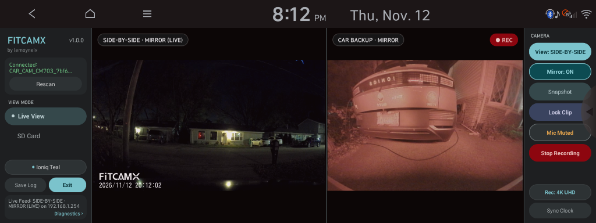
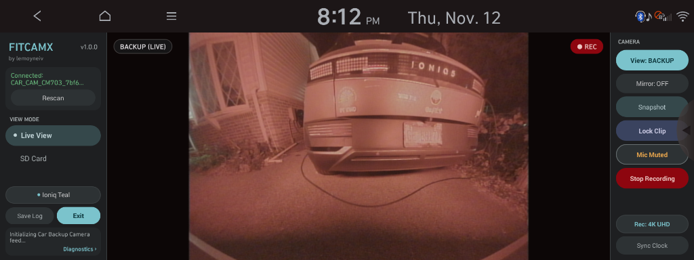
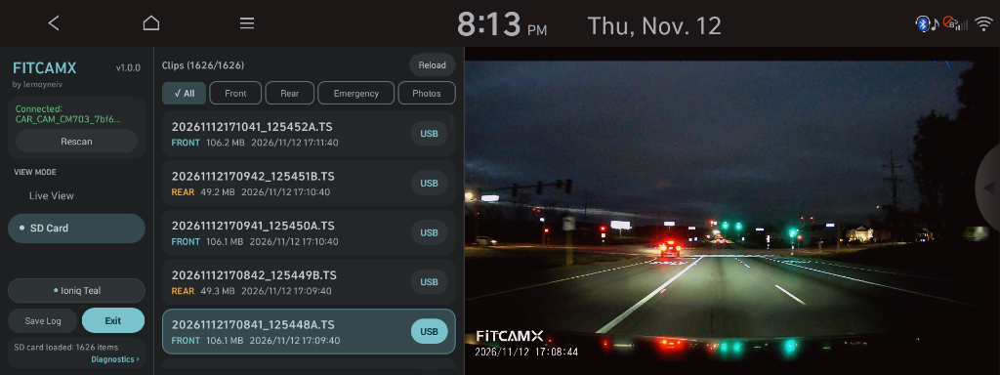
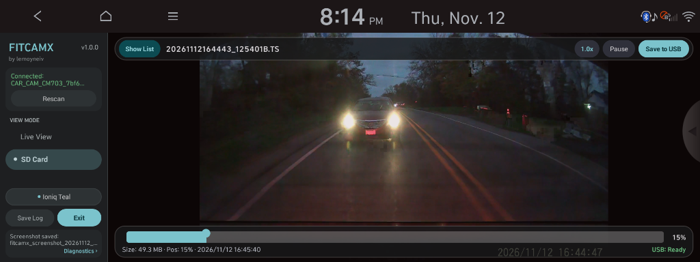
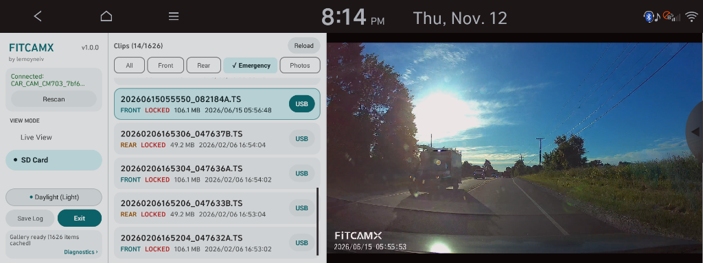
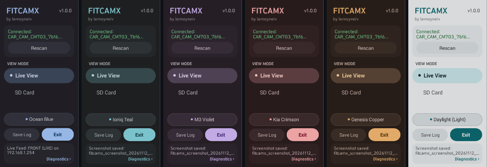
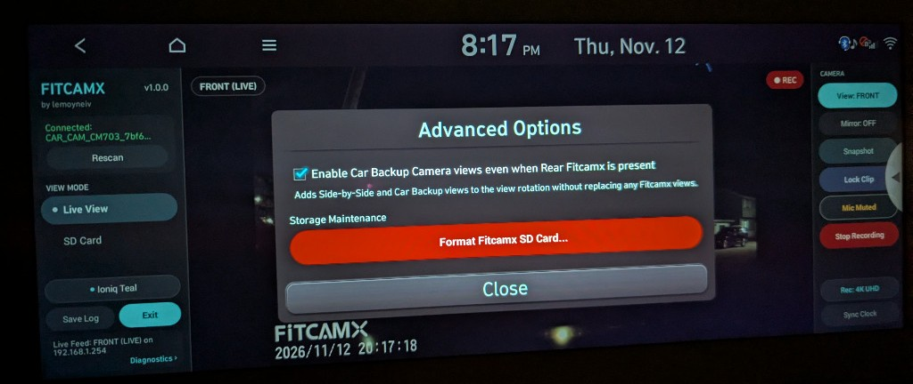

# FITCAMX for Gen5W (Hyundai / Kia / Genesis)

-blue.svg)


[](LICENSE)
[](https://github.com/lemoyneiv/fitcamx-gen5w/releases)

A native widescreen dashcam viewer and controller for Hyundai, Kia, and Genesis **Gen5W** navigation head units (10.25" and 12.3" displays). Stream live video from **FITCAMX** integrated Wi-Fi dashcams, view your vehicle's OEM analog backup camera, review SD card & USB dashcam clips, and export footage directly to a USB flash drive — with zero external codec packs or system modifications required.

**[Screenshots](#screenshots)** · **[Installation](#installation)** · **[Usage Guide](#usage-guide)** · **[`gen5-RearDashcam` Coexistence](#car-backup-camera--coexistence-with-gen5-reardashcam)** · **[Supported Vehicles](#supported-vehicles--hardware)**

---

## Screenshots

### Live View — FITCAMX & Car Backup Camera
*Front live stream (`FRONT`) with driver-side navigation rail and camera control panel:*


*Dual-camera Picture-in-Picture (`DUAL (PIP)`):*


*Rear camera (`REAR`) with `Mirror: OFF` vs. rearview-mirror horizontal flip (`Mirror: ON`):*


*Side-by-Side (`SIDE-BY-SIDE` — FITCAMX Front + Car Backup Camera) and fullscreen OEM Car Backup Camera (`BACKUP`):*





### SD Card & USB Footage Playback
*Indexed clip browser (`All`, `Front`, `Rear`, `Emergency`, `Photos`) with one-tap `USB` export, collapsible full-height playback (`Show List` / scrub bar), and light theme view:*







### Automotive Color Themes & Advanced Options
*Six built-in Material Design 3 palettes (**Ocean Blue**, **Ioniq Teal**, **M3 Violet**, **Kia Crimson**, **Genesis Copper**, and **Daylight**) — tap or long-press the sidebar theme pill to switch live:*



*Long-press the top-left **FITCAMX** header to open **Advanced Options**:*



---

## Installation

### Prerequisites
- A Gen5W head unit rooted with **[HMG-API](https://github.com/VysseCodes/HMG-API)** (`v1.0.0+`, recommended) or **NEMESIS Manager**.

### Method 1: HMG-API USB Installation (Recommended)
1. Download [**`fitcamx-gen5w-v1.0.0-hmgapi-usb.zip`**](https://github.com/lemoyneiv/fitcamx-gen5w/releases/download/v1.0.0/fitcamx-gen5w-v1.0.0-hmgapi-usb.zip) from the [Releases page](https://github.com/lemoyneiv/fitcamx-gen5w/releases/tag/v1.0.0).
2. Extract the archive to the root of a FAT32-formatted USB flash drive (producing `HMGAPI/updates/fitcamx-gen5w-v1.0.0.zip`).
3. Insert the USB drive into the vehicle's multimedia USB port and open **HMG-API** on the head unit.
4. Go to **Updates** → select **FITCAMX Dashcam** → tap **Install** → tap **Apply changes**, then **Restart unit**.

### Method 2: NEMESIS Manager
1. Download [**`fitcamx-gen5w-v1.0.0-nemesis-usb.zip`**](https://github.com/lemoyneiv/fitcamx-gen5w/releases/download/v1.0.0/fitcamx-gen5w-v1.0.0-nemesis-usb.zip) (or [**`fitcamx-gen5w-v1.0.0-nemesis-package.zip`**](https://github.com/lemoyneiv/fitcamx-gen5w/releases/download/v1.0.0/fitcamx-gen5w-v1.0.0-nemesis-package.zip)) and copy it to your USB drive.
2. Open **NEMESIS Manager** on the head unit and install the package.

---

## Usage Guide

### 1. Connecting & Wi-Fi Handover
- **Automatic Connection:** Launching FITCAMX automatically switches the head unit from SoftAP mode to Wi-Fi client mode, connects to your FITCAMX camera, syncs the camera's clock to the car, and starts live video without interrupting dashcam recording.
- **Custom Password or SSID:** If you changed your FITCAMX Wi-Fi password or SSID, tap **Wi-Fi Setup** when prompted (or long-press **Rescan** at any time) to choose your network and save credentials.
- **Clean Exit:** Tapping **Exit** (or backgrounding the app) automatically restores the head unit's prior Wi-Fi/SoftAP configuration so wireless phone projection reconnects seamlessly.

### 2. Live View & Camera Controls
- **View Switching:** Tap **View** on the right-hand camera rail to cycle live feeds:
  - **Dual-camera FITCAMX:** `FRONT` → `DUAL (PIP)` → `REAR` (plus `SIDE-BY-SIDE` and `BACKUP` if enabled in Advanced Options).
  - **Front-only FITCAMX:** `FRONT` → `SIDE-BY-SIDE` → `BACKUP` (automatically enabled on supported analog backup camera trims).
- **Live Mirroring:** Tap **Mirror** to flip the live feed horizontally (`Mirror: ON`) per view — useful for rearview-mirror orientation on rear cameras without flipping saved SD card recordings.
- **Dashcam Controls:** Capture still **Snapshots**, **Lock Clip** to the Emergency folder, start/stop recording, toggle **Rec: 4K UHD / 2K QHD**, mute/unmute the **Microphone**, or **Sync Clock** directly from the right-hand camera rail.

### 3. SD Card & USB Footage Playback
- Switch to **SD Card** in the left sidebar to browse indexed footage across **All**, **Front**, **Rear**, **Emergency**, and **Photos**.
- **Smooth Playback on Gen5W Hardware:** Rear 1080p H.264 clips play at full 30 fps; high-bitrate 4K/2K HEVC front clips use an optimized high-resolution keyframe review mode engineered for the head unit's ARM Cortex-A7 processor. Audio is muted automatically so vehicle radio/media playback is undisturbed.
- **Full-Height Viewing & Export:** Collapse the clip list to expand video to the full `1120×630` viewport with floating scrub controls (`Show List` restores the browser). Tap **USB** on any clip card (or **Save to USB** on the playback bar) to export directly to `/storage/usb0/DashcamFootage/` with live transfer speed and progress.

### 4. Themes, Screenshots, Diagnostics & Advanced Options
- **Color Themes:** Tap the theme pill in the left sidebar (e.g., **Ocean Blue** / **Ioniq Teal**) to pick from 6 automotive palettes, or **long-press** it to cycle palettes live.
- **USB Screenshot:** **Tap** the top-left **FITCAMX** header to save a PNG screenshot to your attached USB drive (`DashcamFootage/`).
- **Advanced Options:** **Long-press** the top-left **FITCAMX** header to open **Advanced Options**:
  - **Enable Car Backup Camera views even when Rear Fitcamx is present:** Adds `Side-by-Side` and `Car Backup` to the Live View rotation on dual-camera FITCAMX setups without replacing any FITCAMX views.
  - **Format Fitcamx SD Card...:** Double-confirmation utility to format the dashcam's microSD card in-car.
- **Save Log & Diagnostics:** Nothing is ever written automatically to internal head-unit flash storage; tap **Save Log** with a USB drive inserted to export `fitcamx_debug_log.txt`, or tap **Diagnostics** to inspect live connection state.

---

## Car Backup Camera & Coexistence with `gen5-RearDashcam`

FITCAMX (`v1.0.0+`) integrates native live viewing for the Gen5W OEM analog backup camera and is specifically engineered to run alongside **[`KramerTech/gen5-RearDashcam`](https://github.com/KramerTech/gen5-RearDashcam)** with zero hardware conflicts.

### OEM Backup Camera Compatibility
- **Standard Analog Backup Camera Trims (`type 0`):** Supported out of the box for both **Side-by-Side** (FITCAMX Front + Car Backup) and fullscreen **Car Backup** live views.
- **360° Surround View Monitor (`SVM`) Trims (`type 6`):** Vehicles with the 360° camera package route video through an external SVM controller rather than the head unit's analog capture memory. FITCAMX detects this automatically at startup and hides the Car Backup views cleanly.

### How Coexistence with `gen5-RearDashcam` Works
If you have `gen5-RearDashcam` installed to record your car's backup camera to USB, both apps work together seamlessly:
1. **Passive Shared Memory Viewing (`Shared` Mode):** When `gen5-RearDashcam` is actively recording to a USB drive, FITCAMX never opens or steals the camera hardware. Instead, it reads live video frames passively from shared `/dev/admem` memory while `gen5-RearDashcam` continues recording uninterrupted `.ts` segments to USB.
2. **Automatic Camera Yielding (`Direct` → `Shared`):** When no USB drive is inserted (so `gen5-RearDashcam` is idle), FITCAMX opens the backup camera directly for live viewing. If you insert a USB drive mid-session or shift out of Reverse while `gen5-RearDashcam` is active, FITCAMX yields hardware ownership so `gen5-RearDashcam` reclaims recording first, then seamlessly switches to passive `Shared` viewing.
3. **Instant OEM Reverse & Parking Button Priority:** Shifting into **Reverse** or pressing the physical dashboard camera button releases camera ownership in under `800 ms` and restores factory parking guidelines so the OEM backup display always takes immediate priority.
4. **Unified USB Gallery:** Recordings and snapshots saved by `gen5-RearDashcam` (`Dashcam/*.ts`, `Saved/*.ts`, and `Snapshots/` on your USB drive) are automatically indexed into FITCAMX's **SD Card** browser (`All`, `Rear`, `Emergency`, and `Photos`) for convenient in-car playback alongside your FITCAMX SD card clips.

---

## Supported Vehicles & Hardware

- **Verified Vehicles:** Actively tested and verified on **2023 Hyundai Ioniq 5 AWD** (standard analog backup camera) and **Kia EV6** (360° SVM trim).
- **Compatible Gen5W Platform:** Designed for Hyundai, Kia, and Genesis vehicles equipped with **Gen5W** 10.25" or 12.3" widescreen navigation head units running Android 4.4.2 KitKat (API 19, ARMv7), including Gen5W models of Ioniq 5, Ioniq 6, Kona, Tucson, Santa Fe, Sonata, Palisade, EV6, EV9, Niro, Sportage, K5, Carnival, Telluride, GV60, G80, GV70, and GV80.
- **Supported Dashcams:** FITCAMX OEM-style integrated Wi-Fi dashcams (Novatek NT96670 / NT96672 / NT96675 series, default IP `192.168.1.254`).

---

## Building from Source

Requires **Linux, macOS, or Windows**, **JDK 8 or 17+**, **Python 3.8+**, and **OpenSSL**. Android SDK (`android-19` + Build-Tools `30.0.3`) and `HMG-API` are downloaded and cached automatically on first build:

```bash
git clone https://github.com/lemoyneiv/fitcamx-gen5w.git
cd fitcamx-gen5w
./build.sh
python3 tests/run_tests.py
```

Signed HMG-API and NEMESIS install packages are output to `dist/`. For architecture details, Novatek CGI documentation, and platform constraints, see [`AGENT_GUIDE.md`](AGENT_GUIDE.md).

---

> [!CAUTION]
> ### Legal Disclaimer & Driver Safety Notice
> **USE AT YOUR OWN RISK:** This software is provided "AS IS", without warranty of any kind. Installing third-party software on automotive infotainment systems carries inherent risks including system instability or warranty impact.
>
> **NON-AFFILIATION:** Independent community open-source project — **not** affiliated with, sponsored by, or endorsed by **Hyundai Motor Group** (Hyundai, Kia, Genesis) or **FITCAMX**.
>
> **DRIVER SAFETY:** Intended strictly for use when the vehicle is **safely parked**. Never interact with video playback or controls while driving. See [`DISCLAIMER.md`](DISCLAIMER.md) for the complete legal notice.

---

## License & Credits

- **License:** Licensed under the [GNU Affero General Public License v3.0 (AGPL-3.0)](LICENSE).
- **LibVLC for Android:** Licensed under [LGPL-2.1+](https://www.videolan.org/legal.html) — Copyright © VideoLAN and VLC authors.
- **HMG-API:** Gen5W modding framework and root IPC specifications by [VysseCodes](https://github.com/VysseCodes/HMG-API) (AGPL-3.0).
- **Gen5W Analog Backup Camera Research:** OEM `/dev/admem` shared-memory ring layout and coexistence integration informed by [`KramerTech/gen5-RearDashcam`](https://github.com/KramerTech/gen5-RearDashcam) (MIT).
